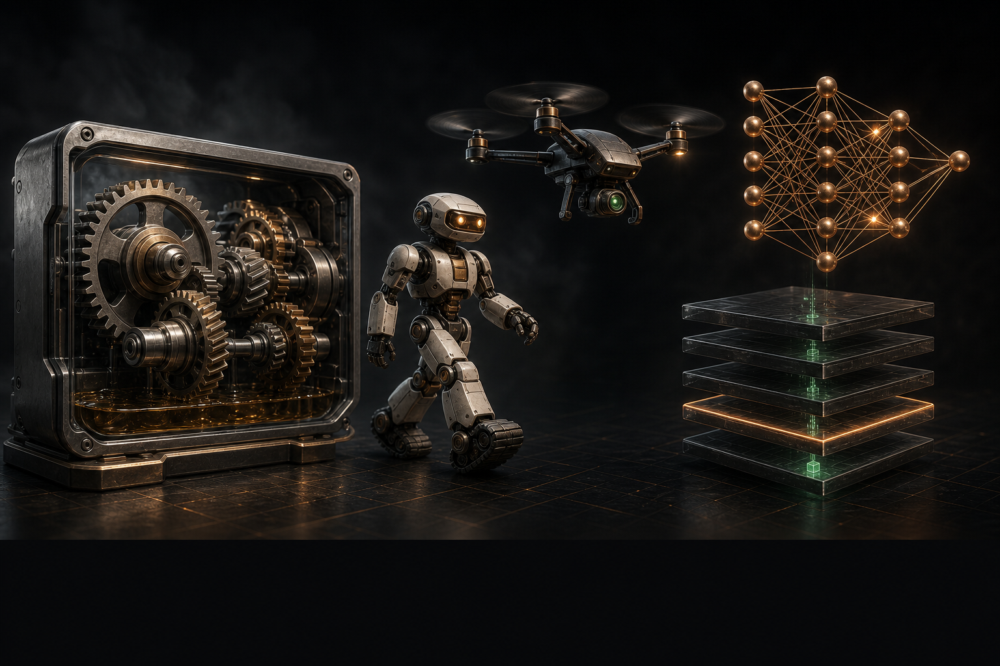
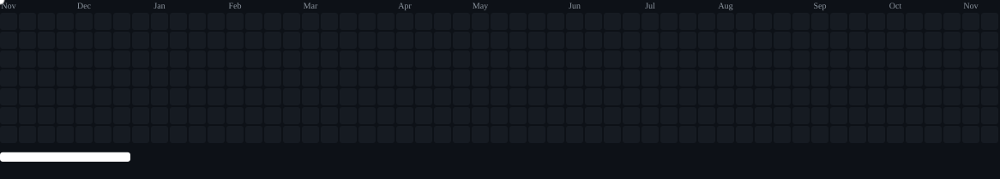

 

---

###  About Me

- 🏭 Mechatronics engineer · founder and general manager of **El Giovani**, a B2B trading company, since 2009.
- 🤖 Creator of **[DEV_OS Engine](https://github.com/Jovo-Jovi/devos-engine)** — AI agents build and review a project task by task, and you approve every gate.
- 🧪 Delivered a bilingual website and staff dashboard for a Cairo medical laboratory.
- 🚀 Building **BETK**, an Arabic-first marketplace, and **B2S**, a white-label business platform.
- 🤝 Open to roles and projects.
- 📫 [jiovanny@kynora.dev](mailto:jiovanny@kynora.dev) · [kynora.dev](https://kynora.dev)

---

### 🌐 Portfolio

Opening sequence · mechanics · humanoid · drone · learning nodes · backend

 

[**→ kynora.dev**](https://kynora.dev)

---

### 🧰 Tech Toolbox

---

### ⭐ Featured Work

#### 🤖 [DEV_OS Engine](https://github.com/Jovo-Jovi/devos-engine)
From an empty folder to a project that AI agents build and review task by task — you approve every gate. Zero-dependency Node CLI and guided setup page · Claude Code, Cursor, Codex or Gemini as reviewer or builder · 20 stacks · 17 guards · 11 GitHub Actions workflows.

 &nbsp;·&nbsp; 

#### 🧪 Medical laboratory website — delivered
Bilingual website and staff dashboard for a Cairo laboratory, replacing its 2018 site: 47 pages, 12 content modules, a partner-lab area, TOTP sign-in, row-level security on every table, no personal data collected. **Next.js · Supabase · TypeScript**

 &nbsp;·&nbsp; 

#### 🛒 BETK — Arabic-first marketplace
A verified storefront for Egypt's informal WhatsApp and Instagram sellers. **Next.js 15 · Supabase · shadcn/ui · TypeScript · Zod**

 &nbsp;·&nbsp; 

#### 🏷️ B2S — Brand to Shelf
Multi-tenant white-label platform consolidating six single-brand tools into one tenanted app. **Vite · React · TypeScript** · [live preview](https://b2s-brand-to-shelf.vercel.app)

---

### 📊 The Stats

 

---

### 👾 Arcade — my contribution grid, five ways

Click a tab to watch that game play across my real GitHub contributions · auto-generated daily by GitHub Actions

👻 &nbsp;<b>Pac-Man</b> &nbsp;·&nbsp; eats my contributions while four ghosts give chase

 

<picture>
  <source media="(prefers-color-scheme: dark)" srcset="https://raw.githubusercontent.com/Jovo-Jovi/Jovo-Jovi/output/pacman-contribution-graph-dark.svg">
  <source media="(prefers-color-scheme: light)" srcset="https://raw.githubusercontent.com/Jovo-Jovi/Jovo-Jovi/output/pacman-contribution-graph.svg">
  
</picture>

🚀 &nbsp;<b>Galaga</b> &nbsp;·&nbsp; a fighter ship blasts the grid (Space-Invaders style)

 

<picture>
  <source media="(prefers-color-scheme: dark)" srcset="https://raw.githubusercontent.com/Jovo-Jovi/Jovo-Jovi/output/galaga-contribution-graph-dark.svg">
  <source media="(prefers-color-scheme: light)" srcset="https://raw.githubusercontent.com/Jovo-Jovi/Jovo-Jovi/output/galaga-contribution-graph.svg">
  
</picture>

🧱 &nbsp;<b>Breakout</b> &nbsp;·&nbsp; a ball bounces around smashing my contribution bricks

 

<picture>
  <source media="(prefers-color-scheme: dark)" srcset="https://raw.githubusercontent.com/Jovo-Jovi/Jovo-Jovi/output/breakout-contribution-graph-dark.svg">
  <source media="(prefers-color-scheme: light)" srcset="https://raw.githubusercontent.com/Jovo-Jovi/Jovo-Jovi/output/breakout-contribution-graph.svg">
  
</picture>

🫧 &nbsp;<b>Puzzle Bobble</b> &nbsp;·&nbsp; a cannon fires bubbles to pop matching clusters

 

<picture>
  <source media="(prefers-color-scheme: dark)" srcset="https://raw.githubusercontent.com/Jovo-Jovi/Jovo-Jovi/output/puzzle-bobble-contribution-graph-dark.svg">
  <source media="(prefers-color-scheme: light)" srcset="https://raw.githubusercontent.com/Jovo-Jovi/Jovo-Jovi/output/puzzle-bobble-contribution-graph.svg">
  
</picture>

💣 &nbsp;<b>Bomberman</b> &nbsp;·&nbsp; two bombers blast contribution cells across the graph

 

<picture>
  <source media="(prefers-color-scheme: dark)" srcset="https://raw.githubusercontent.com/Jovo-Jovi/Jovo-Jovi/output/bomberman-contribution-graph-dark.svg">
  <source media="(prefers-color-scheme: light)" srcset="https://raw.githubusercontent.com/Jovo-Jovi/Jovo-Jovi/output/bomberman-contribution-graph.svg">
  
</picture>

---

### 🤝 Connect

  

